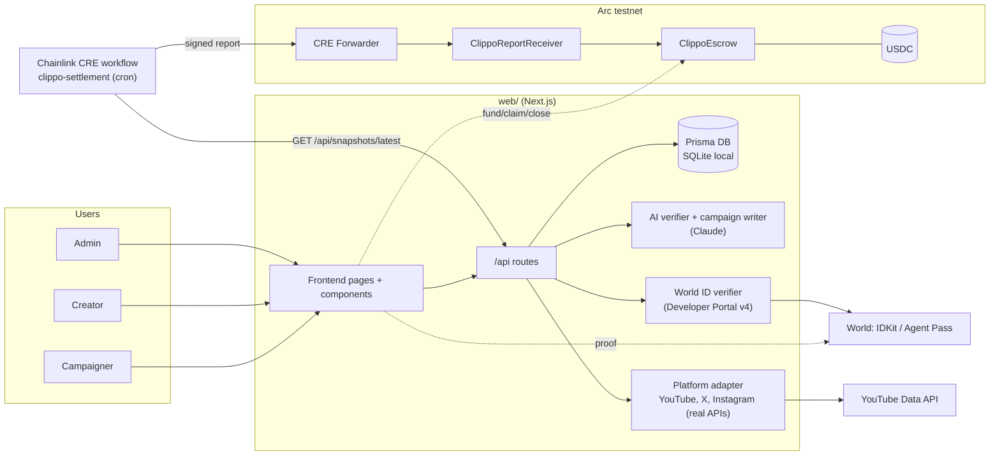
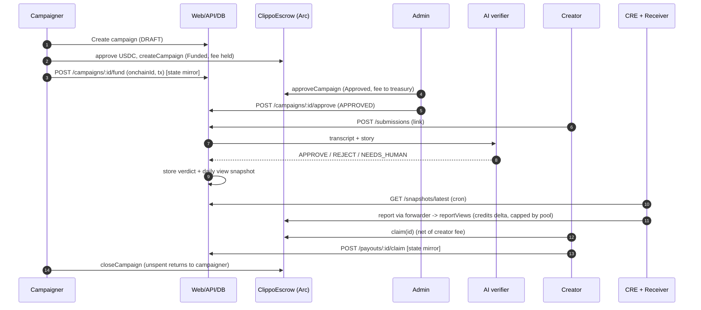

# Architecture

## System

Dotted links are not implemented against real services in the current build (see the README status table).

## Money flow

What is real in this flow:

- Every step on `ClippoEscrow` is implemented and tested in `contracts/`. From the web app they are currently simulated by `useEscrow()` (fake tx hashes); the API only mirrors state.
- HumanSplit: `POST /api/campaigns/:id/split` requires a fresh World ID proof (the Agent Pass step) and creates PENDING payouts in the DB. The backend does not call on-chain `approveSplit`.
- Reject path: `rejectCampaign` on-chain refunds the full pool including the held fee.
- Known gap: `/api/snapshots/latest` returns `campaignId` (DB cuid) and `onchainId`. The CRE `snapshot.ts` drops rows whose `campaignId` is not a uint256, so the endpoint must emit the numeric `onchainId` as the id (or the workflow must read `onchainId`) before a live run works. Verify before demoing.

## Components to files

| Component | Files |
| --- | --- |
| Frontend | `web/src/app/(site)/*`, `web/src/components/*`, data seam `components/api.ts` |
| API | `web/src/app/api/**/route.ts`, `web/src/lib/{auth,http,domain,earnings,snapshots}.ts` |
| DB | `web/prisma/schema.prisma` (User, Channel, Campaign, Submission, Verdict, ViewSnapshot, Payout) |
| AI verifier | `web/src/lib/ai/{verifier,llm,duplicates,campaign-writer}.ts` |
| World ID | `web/src/lib/worldid/index.ts`, `web/src/app/api/worldid/verify/route.ts`, `components/WorldCheck.tsx` |
| Platforms | `web/src/lib/youtube/index.ts` |
| Escrow | `contracts/src/ClippoEscrow.sol`, `ClippoReportReceiver.sol`, `MockUSDC.sol`, `script/Deploy.s.sol` |
| CRE | `cre/workflows/clippo-settlement/{main,snapshot}.ts` |
